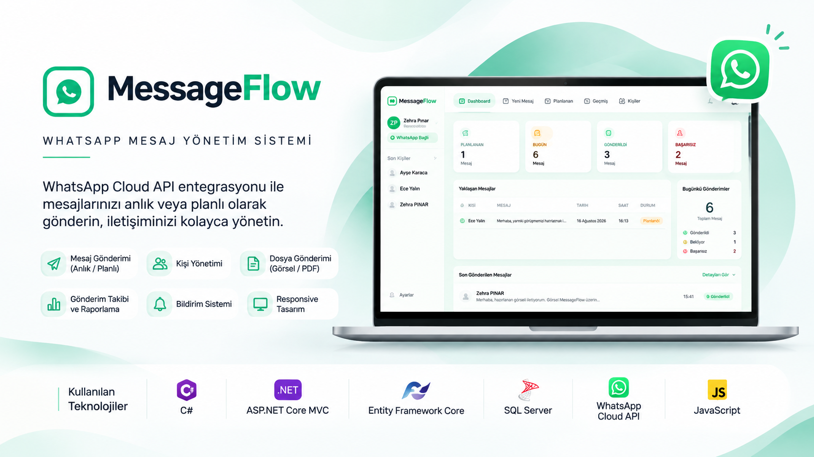

<div align="center">
  
</div>

<br>

<div align="center">


</div>
<br>

```csharp
public class ZehraPinar
{
    public string Role => "Junior Software Developer";

    public string[] Technologies =>
    [
        "C#",
        "ASP.NET Core MVC",
        "Entity Framework Core",
        "SQL Server",
        "JavaScript"
    ];

    public string[] Interests =>
    [
        "Backend Development",
        "Software Testing",
        "Enterprise Applications"
    ];

    public string CurrentlyLearning =>
        "Advanced T-SQL";
}
```
<br>

<h2 align="center">🚀 Öne Çıkan Projelerim</h2>

<h3>💬 MessageFlow</h3>

<p>
  WhatsApp Cloud API entegrasyonuyla anlık ve zamanlanmış
  mesaj gönderimini sağlayan, kişi ve mesaj yönetimi
  özelliklerine sahip bir web uygulaması.
</p>

<p align="center">
  <a href="https://github.com/zehrapinar/MessageFlow">
    
  </a>
</p>

<p align="center">
  
  
  
  
</p>

<p align="center">
  <a href="https://github.com/zehrapinar/MessageFlow">
    
  </a>
</p>

<br>

---
